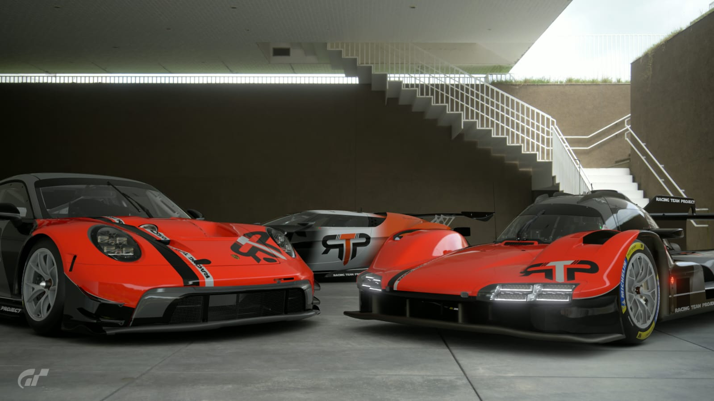

# RTP Racing Team Project

  <a href="https://racingteamproject.eu"><b>🌐 racingteamproject.eu</b></a> ·
  <a href="https://discord.gg/CTrxTXyPJx">Discord</a> ·
  <a href="https://www.instagram.com/rtp_racingteamproject">Instagram</a> ·
  <a href="https://www.youtube.com/@RTPRacingTeamProject">YouTube</a> ·
  <a href="https://www.twitch.tv/racingteamproject_rtp">Twitch</a>

Equipa portuguesa de sim racing em **Gran Turismo 7**. Este repositório é o site oficial da RTP: pilotos, calendário, competições, classificações, garagem e ferramentas para a equipa.

## 📄 Páginas

| Página | O que tem |
|---|---|
| [Início](https://racingteamproject.eu) | Equipa, pilotos, patrocinadores e competições |
| [Página do piloto](https://racingteamproject.eu/piloto.html?id=FVenda117) | DR/SR, Edge Score, gráfico dos pontos de Driver Rating, Daily Races e DG-Edge em direto |
| [Calendário](https://racingteamproject.eu/calendar.html) | Próximas corridas e eventos |
| [Liga Endurance](https://racingteamproject.eu/liga-endurance.html) | Liga da RTP: rondas, resultados e classificações |
| [Classificações](https://racingteamproject.eu/standings.html) | Resultados das competições em que a RTP participa |
| [Garagem](https://racingteamproject.eu/garage.html) | Carros e pinturas da equipa por grupo |
| [Time Trial 1KM](https://racingteamproject.eu/timetrial.html) | Desafio de tempos da comunidade |
| [Calculadora](https://racingteamproject.eu/calculadora.html) | Calculadora de combustível e estratégia |
| [Inscrição](https://racingteamproject.eu/inscricao.html) · [Contacto](https://racingteamproject.eu/contact.html) | Juntar-se à equipa / falar connosco |

## 🛠️ Como funciona

Site 100% estático (HTML, CSS e JavaScript), alojado no **GitHub Pages**: sem servidor nem base de dados.

- `js/data.js` — pilotos, patrocinadores, competições e classificações
- `js/garage-data.js` — carros da garagem (fotos em `images/garage/cars/<grupo>/<carro>/`)
- `js/edge-dr.js`, `js/edge-stats.js`, `js/edge-dailies.js` — dados do [DG-Edge](https://www.dg-edge.com) de cada piloto, atualizados automaticamente de hora a hora
- `tools/` — scripts de recolha dos dados do DG-Edge

Depois de alterar CSS/JS, atualizar o `?v=` nas páginas HTML para os browsers carregarem a versão nova.

---

© RTP Racing Team Project · Dados de pilotos via DG-Edge · Gran Turismo é marca registada da Sony Interactive Entertainment.
